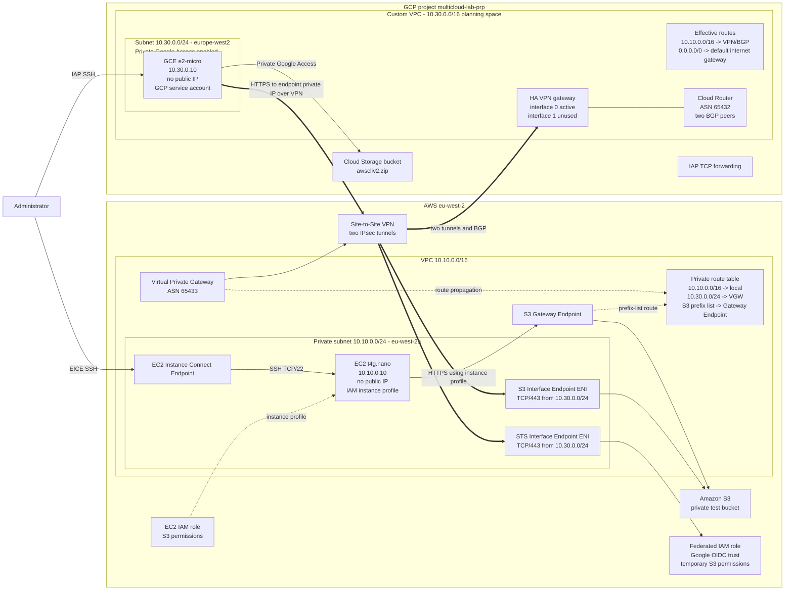
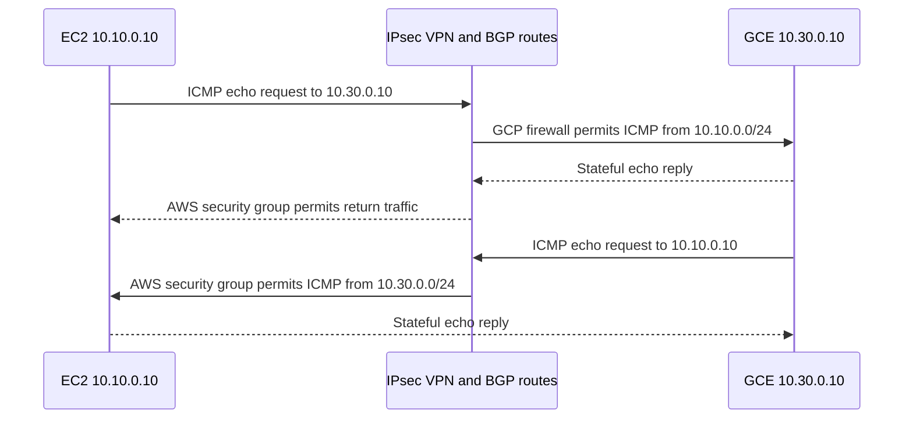
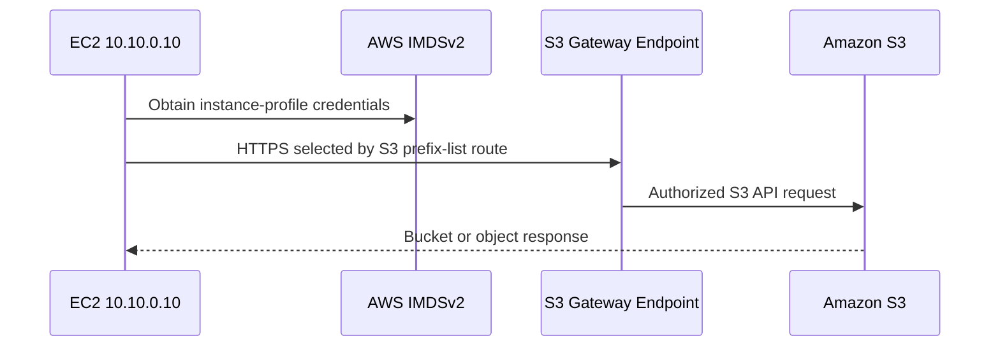
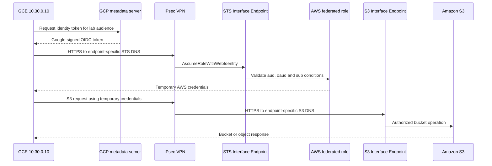
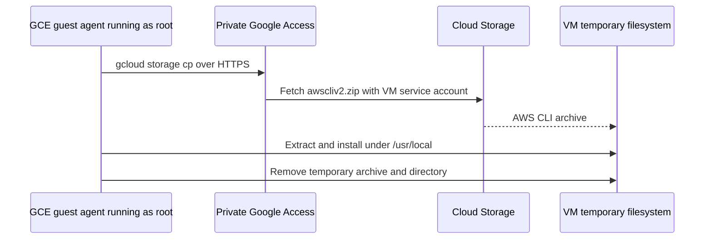

# Architecture

## Phase 5 - Private service access and workload federation

AWS uses VPC CIDR `10.10.0.0/16`; GCP uses a global custom-mode VPC with a
regional `10.30.0.0/24` subnet. The two networks exchange routes through two
IPsec tunnels and BGP. Phase 4 proved workload connectivity. Phase 5 adds
private access to S3 from both clouds and federates the GCE workload identity
into AWS without storing long-lived AWS credentials.

The diagram shows logical service flows rather than every IAM or firewall
attachment. Both Interface Endpoints use one ENI in `eu-west-2a` and share a
security group accepting TCP/443 from `10.30.0.0/24`. Private DNS is disabled,
so the GCP client uses endpoint-specific DNS names. This single-AZ layout is
appropriate for the lab but is not a production availability design.

## Phase 4 workload flow

The successful tests prove private workload reachability and correct security
controls. Route and tunnel state correlate the path, but packet-level proof is
deferred until VPC Flow Logs are enabled in Phase 6.

## EC2 to S3

The EC2 security group permits HTTPS egress to the S3 managed prefix list. The
Gateway Endpoint is associated with the private subnet route table and has no
hourly endpoint charge. Gateway Endpoints are not transitive through a VPN, so
this path cannot serve the GCP workload.

## GCP federation and S3

The AWS trust pins the Google service account numeric identity and custom
audience. No static AWS key and no customer-managed AWS OIDC provider are
needed for the built-in `accounts.google.com` provider. Tokens and temporary
credentials are deliberately absent from repository files and documentation.

## GCP startup bootstrap

The startup script runs as root from a transient metadata-script location and
uses absolute paths under `/tmp`. The VM service account has
`roles/storage.objectViewer` on the bootstrap bucket. The explicit default
route and Private Google Access make Google API destinations reachable without
assigning a public IP. They do not provide general Internet access without an
external IP or Cloud NAT.

## Security and availability scope

- The S3 IAM policy intentionally grants broad `s3:*` access for this ephemeral
  learning iteration. It is not a least-privilege production example.
- The VPC endpoints currently use their default permissive endpoint policies.
- The Interface Endpoint security group accepts the whole GCP lab subnet.
- Both Interface Endpoints and both initial VPN tunnels lack the complete
  multi-AZ/multi-interface topology expected from a production design.
- Cloud-native flow telemetry is not enabled yet; application success plus
  routing and endpoint state cannot prove every packet hop by themselves.

## Address plan

| Environment | CIDR | Role |
| --- | --- | --- |
| AWS VPC | `10.10.0.0/16` | Deployed AWS address space |
| AWS subnet | `10.10.0.0/24` | EC2 and endpoint ENIs |
| AWS VM | `10.10.0.10/32` | Test workload |
| GCP planning space | `10.30.0.0/16` | Conceptual reservation |
| GCP subnet | `10.30.0.0/24` | Regional workload subnet |
| GCP VM | `10.30.0.10/32` | Test workload |
| Azure VNet | `10.20.0.0/16` | Reserved for Phase 10 |
