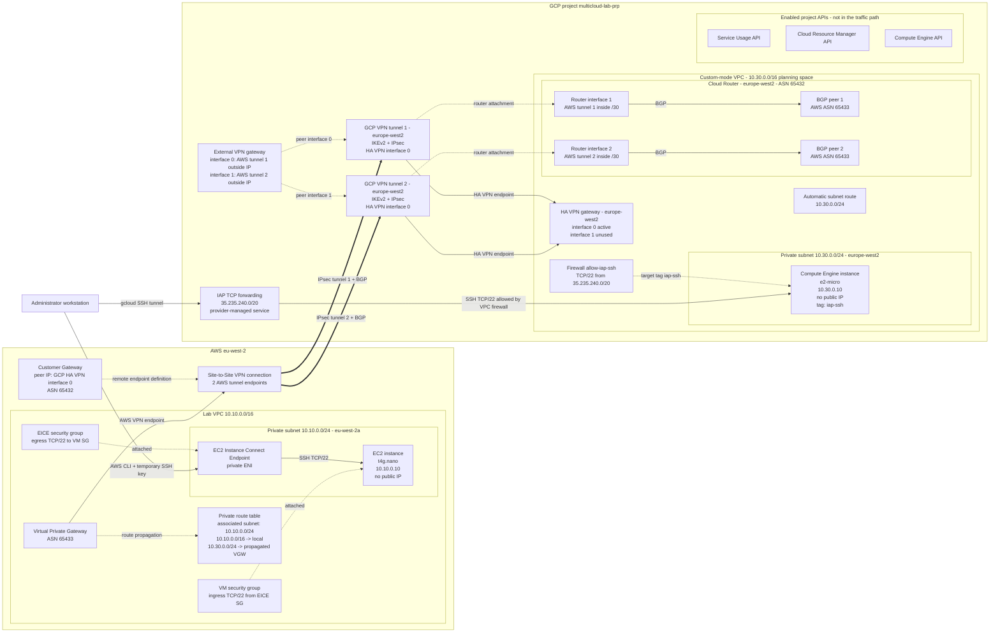
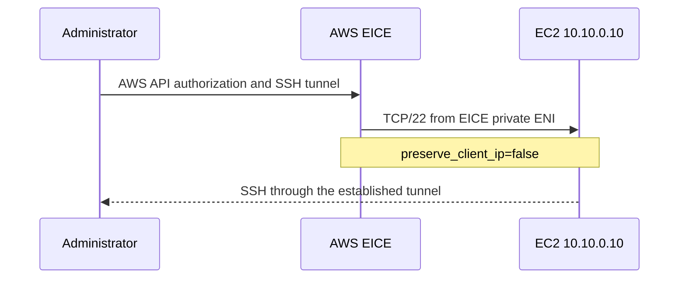
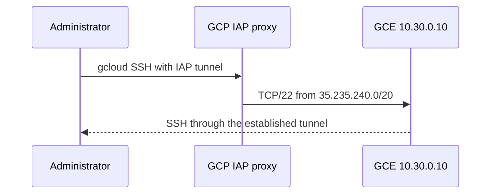
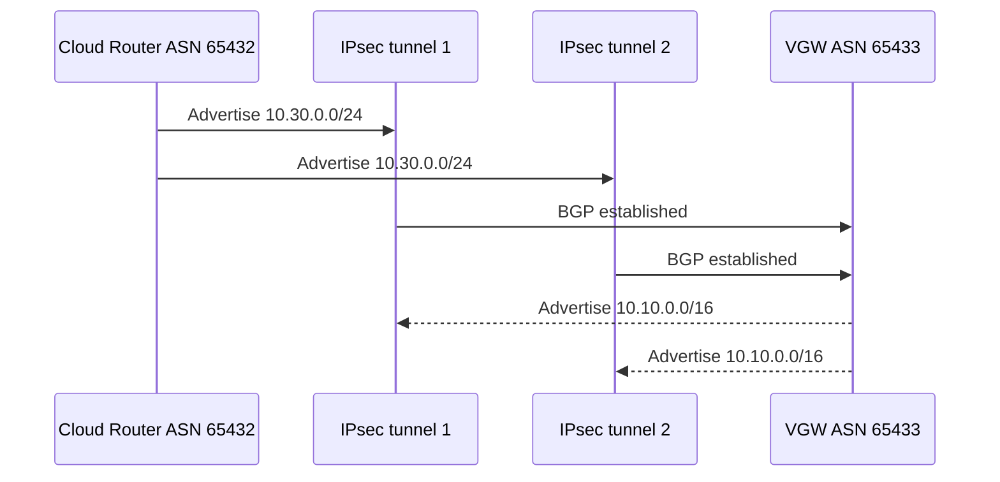

# Architecture

## Phase 3 - IPsec and dynamic routing control plane

AWS has a regional VPC CIDR. GCP has a global custom-mode VPC with a regional
subnet; `10.30.0.0/16` is a planning reservation, not a VPC attribute.
Nested boxes show resource scope. Solid arrows show network or control-plane
connections; dashed arrows show configuration attachments and peer mappings.

No Internet default route, Internet gateway or NAT is deployed in either lab
network. The VPN control plane is healthy and exchanges both cloud prefixes.
The VMs remain reachable for administration through EICE and IAP. Workload
traffic between them has not been authorized or tested yet.

AWS DNS resolution is enabled and DNS hostnames are disabled. The GCP VPC uses
regional dynamic routing mode and MTU 1460; its subnet is IPv4-only and Private
Google Access is disabled. These values are explicit so later phases can show
which requirement causes each change.

## Administrative traffic flows

The observed AWS SSH connection was
`10.10.0.205:22854 -> 10.10.0.10:22`. AWS confirmed that `10.10.0.205`
belonged to the endpoint ENI. The EICE and VM security groups reference each
other for TCP/22; no broad source CIDR is allowed.

The observed GCP SSH connection was
`35.235.242.2:40383 -> 10.30.0.10:22`. The source belongs to the documented
IAP range and matched the firewall rule targeting the VM's `iap-ssh` tag.
Authentication currently uses temporary SSH keys in instance metadata; OS
Login remains a possible hardening iteration.

## VPN control plane

Both tunnels terminate on GCP HA VPN interface `0` because one AWS Customer
Gateway can reference only one GCP outside IP. GCP therefore warns that the HA
VPN gateway is not fully redundant. This is expected: interface `1` remains
unused until a second AWS VPN connection adds tunnels 3 and 4.

## Address plan

| Environment | CIDR | Status |
| --- | --- | --- |
| AWS VPC | `10.10.0.0/16` | Deployed |
| AWS subnet | `10.10.0.0/24` | Deployed |
| AWS VM | `10.10.0.10/32` | Deployed |
| GCP planning space | `10.30.0.0/16` | Reserved conceptually |
| GCP subnet | `10.30.0.0/24` | Deployed |
| GCP VM | `10.30.0.10/32` | Deployed |
| Azure VNet | `10.20.0.0/16` | Future phase |

Dual stack is deferred. Additional subnets can be introduced later; migration
to `for_each` should use `moved` blocks to preserve existing state addresses.
