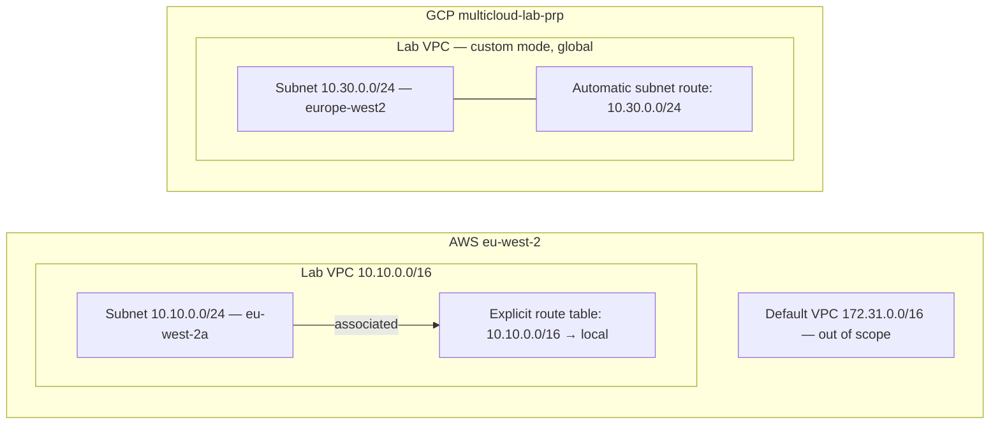

# Architecture

## Phase 1 — isolated IPv4 networks

AWS has a regional VPC CIDR. GCP has a global custom-mode VPC with a regional
subnet; `10.30.0.0/16` is a planning reservation, not a VPC attribute.

No Internet default route, gateways, VPN or workloads are deployed in the lab
networks. GCP default Internet routes are deleted during network creation.
Routing availability does not itself grant access: firewall rules, security
groups and NACLs will be considered when introducing workloads.

AWS DNS resolution is enabled and DNS hostnames are disabled. The GCP VPC uses
regional dynamic routing mode and MTU 1460; its subnet is IPv4-only and Private
Google Access is disabled. These values are explicit so later phases can show
which requirement causes each change.

## Address plan

| Environment | CIDR | Status |
| --- | --- | --- |
| AWS VPC | `10.10.0.0/16` | Deployed |
| AWS subnet | `10.10.0.0/24` | Deployed |
| GCP planning space | `10.30.0.0/16` | Reserved conceptually |
| GCP subnet | `10.30.0.0/24` | Deployed |
| Azure VNet | `10.20.0.0/16` | Future phase |

Dual stack is deferred. Additional subnets can be introduced later; migration
to `for_each` should use `moved` blocks to preserve existing state addresses.
